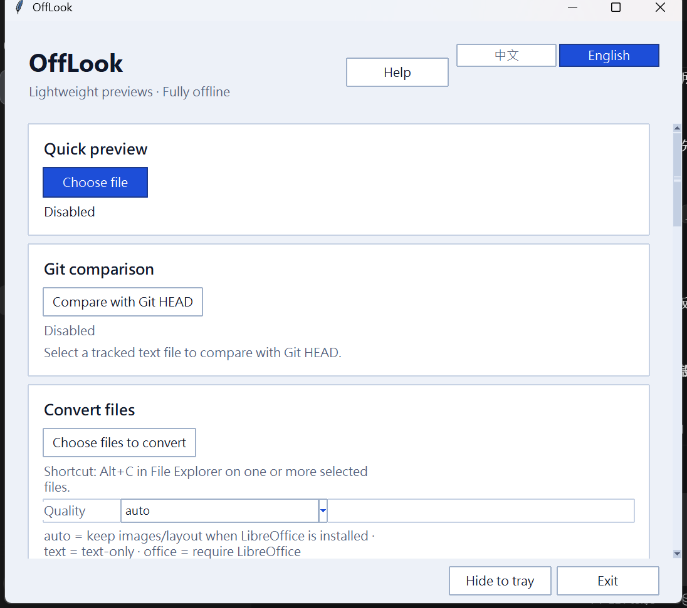

# OffLook

An offline file previewer for Windows with GUI and CLI interfaces. Previews and file comparisons run locally without a network connection. The optional AI file assistant contacts the service you configure only when you run it.



The interface is bilingual: switch between English and Chinese with the buttons at the top right. See [Getting started](docs/getting-started.md) for current instructions.

## Install and launch

Download and extract the ZIP from GitHub, then open PowerShell in the folder containing pyproject.toml. Requires 64-bit Python 3.11–3.15 for Windows, pip, Python Launcher, and Tcl/Tk.

```powershell
py -m pip install --user --only-binary=:all: -r requirements.txt
py -m pip install --user --only-binary=:all: -e .
py -m offlook
```

No virtual environment is used. The initial installation downloads dependencies; previews do not require a network connection. OffLook has not been published to PyPI: do not install an unrelated package with the same name. Keep the project folder after installation.

## Main controls

The left sidebar separates **File tools** (preview, compare, convert), **Search files**, **Filter files**, **AI file assistant**, and **Settings**. Switching pages keeps your inputs and results.

- Pick the interface language with the **中文 / English** buttons at the top right; the choice is saved to the local configuration file and applies immediately.
- Click **Choose file** in the main window, or select one file in File Explorer or on the desktop and press the default **Ctrl+Space** shortcut.
- Use **Search files** to choose a local folder, search recursively by filename, and filter by document type, including Word, Excel, and PowerPoint files; double-click a result to preview it.
- In File Explorer, select one local folder, or open a local folder with nothing selected, and press the default **Ctrl+Q** shortcut. It opens the search page, loads the folder, and focuses the filename field. Press Enter or click **Search** to run it. A selected regular file or multiple items is an error.
- In **File comparison**, click **Compare two files** to open the Windows file picker. Hold Ctrl to select exactly two files in the same folder, then click **Open**. Or select two local files in File Explorer or on the desktop and press **Ctrl+Alt+D** (configurable). OffLook sorts the paths to set the initial order; **Swap files** reverses it. **Split** and **Unified** views show removals in red (`-`), additions in green (`+`), and highlight changed text within paired lines. No Git installation, repository, or GitHub account is required.
- Click **Choose files to convert** under **File tools**, or select files in Explorer and press the default **Alt+C**. The shortcut opens only the **Convert to** dialog, without restoring the main window. Choose a format and press Enter or click **Convert**. Progress, output paths, or errors stay in that dialog. Before starting, use **Cancel**, Esc, or X to dismiss it; when done, use **Close**. See [conversion formats and requirements](docs/getting-started.md#6-convert-filter-and-use-ai).
- In **Filter files**, choose a folder and check the formats you want. In File Explorer, press **Ctrl+Alt+F** (configurable) over a selected local folder or the current folder with nothing selected to open only the standalone filter window. Click **Apply filter** to list matches recursively; no checked categories means all types. Double-click a result to preview it.
- The optional **AI file assistant** can list, filter, move, copy, and organize local files. Saving settings does not contact the service. Clicking **Run with AI** sends the instruction to the configured service and may send tool results such as paths, filenames, and sizes. The API key is saved in plaintext in the local JSON configuration.
- To test the configured Search files key separately, run `py -m offlook diagnose-search-shortcut`, or `py -m offlook --config '<path>' diagnose-search-shortcut` for a custom config. The main app and other instances must release that key first. The diagnostic creates no GUI, tests the saved key even if the shared switch is off, and does not change settings; Ctrl+C exits successfully.
- Under **Settings → Shortcut settings**, choose **Preview**, **Search files**, **Compare files**, **Convert files**, or **Filter files**. **Record shortcut** and **Reset default** change only that action's draft; **Apply** saves only the selected key. Switching actions preserves separate drafts; Esc cancels recording. The previous active key is kept if registration or saving fails.
- **Enable global shortcuts** applies immediately to all actions, separately from Apply. All saved combinations must differ, even when disabled. An occupied key makes only that action unavailable; release it and Apply again or choose another key. The cards and Help show active keys and any configured/active mismatch. Manual feature controls still work with global shortcuts disabled.
- In **Settings**, click **Add to PATH** and reopen PowerShell as instructed to use `offlook preview '.\README.md'`.
- Scroll with the mouse wheel over buttons, labels, and the file path field without aiming at the scrollbar. Lists and text areas keep their own scrolling while they have hidden content. The **Quality** dropdown keeps its native wheel behavior and can change the selected value.
- Close a preview with Esc or Space, navigate PDF pages, or keep the current preview on top. Images and PDFs refresh at higher resolution when the window grows. **Fit** does not enlarge small source images; manual zoom is separate.
- Unsupported or disabled formats show metadata such as type, size, path, and timestamps rather than binary contents. DOCX previews show metadata even though DOCX text can be compared.
- The main window's X button hides it only if the system tray is available. Double-click the tray icon to reopen it, or use **Exit** to close OffLook completely. You can also enable startup at sign-in.
- **Help** or F1 opens the built-in guide. Reopen Help after switching languages. See [Getting started](docs/getting-started.md) for full instructions and [API](docs/api.md) for integration interfaces.

```powershell
py -m offlook preview '.\README.md'
py -m offlook --background
py -m offlook filter '.\docs' --kind markdown
py -m offlook filter '.\docs' --gui --kind markdown
```

For `filter`, omit the folder to use the terminal's current directory. See `py -m offlook filter --help` for options.

## Supported formats and limits

Previews support text, Markdown, code, CSV, common images, and static PDFs. Markdown uses lightweight formatting, images show only the first frame, and password-protected PDFs are not supported. Defaults are 10 MiB and a 5-second timeout: oversized media shows metadata only, and text may be truncated. Empty text may show **Empty file**. Raster output is limited to 4,096 physical pixels per edge and 8,388,608 pixels total.

Comparison supports plain text (UTF-8 or Unicode with a byte-order mark), including TXT, Markdown, RST, CSV, and source code, as well as Word `.docx` body paragraphs and table text. You can compare across formats. Markdown is compared as source, and Word layout is not compared. The default limits are 2,000,000 bytes and 20,000 lines per file; over-limit inputs are rejected, not truncated.

Previews and comparisons accept local regular files. At the shortcut selection boundary, network paths, reparse points, and cloud-recall paths are rejected. Search and filtering skip symbolic links and inaccessible subfolders. OffLook does not execute code or CSV formulas as part of previewing and does not invoke third-party thumbnail handlers. Conversion runs locally. The optional AI assistant is the only built-in network feature; the operating system, synchronization software, and other external components are outside OffLook's control.

requirements.txt is the single source of runtime dependencies; pyproject.toml defines packaging and entry points. OffLook uses the [MIT license](LICENSE); dependencies retain their respective licenses.
