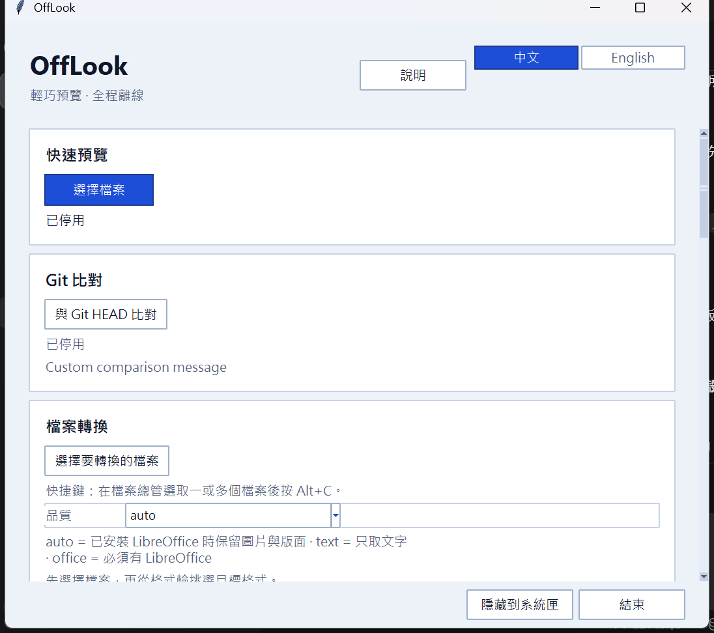

# OffLook

An offline file previewer for Windows with GUI and CLI interfaces. All files are processed locally, without uploads or external links.



The interface is bilingual: switch between English and Chinese with the buttons at the top right. See [MODIFICATIONS.md](MODIFICATIONS.md) for the changes in this build and [GITHUB-SETUP.md](GITHUB-SETUP.md) for the Git workflow.

## Install and launch

Download and extract the ZIP from GitHub, then open PowerShell in the folder containing pyproject.toml. Requires 64-bit Python 3.11–3.15 for Windows, pip, Python Launcher, and Tcl/Tk.

```powershell
py -m pip install --user --only-binary=:all: -r requirements.txt
py -m pip install --user --only-binary=:all: -e .
py -m offlook
```

No virtual environment is used. The initial installation downloads dependencies; previews do not require a network connection. OffLook has not been published to PyPI: do not install an unrelated package with the same name. Keep the project folder after installation.

## Main controls

- Pick the interface language with the **中文 / English** buttons at the top right; the choice is saved to the local configuration file and applies immediately.
- Click **Choose file** in the main window, or select one file in File Explorer or on the desktop and press the default **Ctrl+Space** shortcut.
- Use **Search files** to choose a local folder, search recursively by filename, and filter by document type, including Word, Excel, and PowerPoint files; double-click a result to preview it.
- In File Explorer, select one local folder, or open a local folder with nothing selected, and press the default **Ctrl+Q** Search files shortcut. It loads the folder and focuses the filename field; click **Search** to run the search. A selected regular file or multiple items is an error.
- Use the separate **Git comparison** card and click **Compare with Git HEAD**, or press the default **Ctrl+Alt+D** shortcut on a selected Explorer file, to compare its working-tree contents with the latest committed version. Added, deleted, and modified lines are highlighted.
- Select one or more files in File Explorer and press the default **Alt+C** conversion shortcut to open a **conversion wheel**, then pick a target format to convert locally — images ↔ PNG/JPEG/BMP/GIF/TIFF/WebP/ICO, images → PDF, PDF → images, text/Markdown/code/CSV → PDF/TXT/Word, and Word/Excel/PowerPoint → PDF/TXT/CSV/images. A **Quality** selector chooses `auto` (keep images/layout via LibreOffice when installed), `text` (text-only), or `office` (require LibreOffice). You can also click **Choose files to convert**.
- Use the **Filter files** card to browse a folder and check any combination of formats; **Apply filter** lists every matching file and double-clicking one previews it.
- The **AI file assistant** card is an opt-in port for your own AI. Enter an OpenAI-compatible base URL (e.g. DeepSeek), model, and API key, then describe a file task in plain language; the assistant can call OffLook's local list/filter/move/copy/organize tools to archive and organize files.
- To test the configured Search files key separately, run `py -m offlook diagnose-search-shortcut`, or `py -m offlook --config '<path>' diagnose-search-shortcut` for a custom config. The main app and other instances must release that key first. The diagnostic creates no GUI, tests the saved key even if the shared switch is off, and does not change settings; Ctrl+C exits successfully.
- In **Shortcut settings**, choose **Preview**, **Search files**, **Git comparison**, or **Convert files**. **Record shortcut** and **Reset default** change only that action's draft; **Apply** saves only the selected key. Switching actions preserves separate drafts; Esc cancels recording. The previous active key is kept if registration or saving fails.
- **Enable global shortcuts** applies immediately to all four actions, separately from Apply. All saved combinations must differ, even when disabled. An occupied key makes only that action unavailable; release it and Apply again or choose another key. The cards and Help show active keys and any configured/active mismatch. Manual feature controls still work with global shortcuts disabled.
- Click **Add to PATH** and reopen PowerShell as instructed to use `offlook preview '.\README.md'`.
- Scroll with the mouse wheel anywhere in the main window or in a preview window — including over buttons, labels, the file path field, and the Quality selector — without aiming at the scrollbar. Lists and text areas keep their own scrolling while they have hidden content.
- Close a preview with Esc or Space, navigate PDF pages, or keep the current preview on top. Images and PDFs refresh at higher resolution when the window grows.
- Unsupported or disabled formats show a type icon, size, full location, timestamps, and other metadata, not binary contents.
- The main window's X button hides it to the system tray; double-click the tray icon to reopen it. **Exit** closes the application completely. You can also enable startup at sign-in.
- **Help** or F1 opens the built-in guide. See [Getting started](docs/getting-started.md) for full instructions and [API](docs/api.md) for integration interfaces.

```powershell
py -m offlook preview '.\README.md'
py -m offlook --background
```

## Supported formats and limits

Supports text, Markdown, code, CSV, common images, and static PDFs. Markdown uses lightweight formatting, images show only the first frame, and password-protected PDFs are not supported. Defaults are 10 MiB and a 5-second timeout: text is truncated, while oversized media shows metadata only. Output is limited to 4,096 physical pixels per edge and 8,388,608 pixels total; small source images are not enlarged.

Only local regular files are accepted for previews and comparisons; Search files accepts local folders. Network paths, reparse points, and cloud-recall paths are rejected at the shortcut selection boundary. OffLook does not execute code or CSV formulas or invoke third-party thumbnail handlers. The operating system, synchronization software, and other external components are outside its control, so absolute prevention of data leakage cannot be guaranteed. Conversion runs locally with Pillow/pypdfium2 (and optional LibreOffice); the optional AI assistant is the only network feature and makes requests solely to the endpoint you configure.

requirements.txt is the single source of runtime dependencies; pyproject.toml defines packaging and entry points. OffLook uses the [MIT license](LICENSE); dependencies retain their respective licenses.
