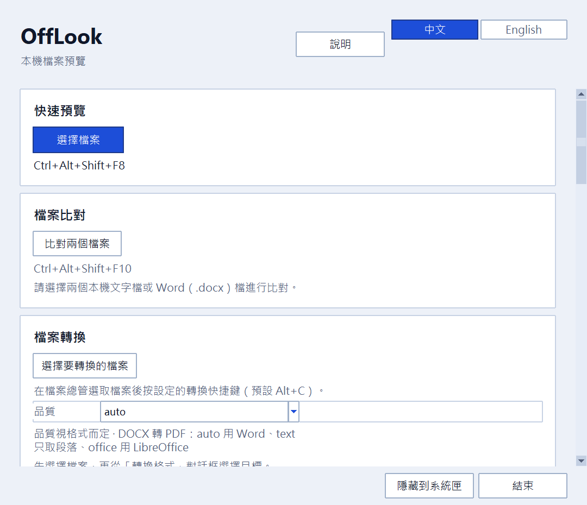

# OffLook

[English](README.md) | **繁體中文**

OffLook 是一款開放原始碼的 Windows 工具，讓你在檔案總管就能快速查看和處理本機檔案。只是想確認哪一份才是要找的報告，卻得把候選檔案一個個用 PDF 閱讀器或編輯器打開？讓 OffLook 在系統匣執行，選取檔案後按 **Ctrl+Space** 預覽，再按 **Esc** 回到檔案總管繼續瀏覽。

- **找出你要的檔案。** 用部分檔名和一種或多種檔案類型篩選資料夾及其子資料夾，從結果直接預覽 PDF、圖片、Markdown、純文字、程式碼和 CSV，不必為每種格式切換程式。
- **看清兩個版本改了什麼。** 並排比較純文字或 Word（`.docx`）檔案，也能拿 Word 和純文字互比。OffLook 會標出文字差異，不需要 Git 或 Microsoft Word。
- **把檔案轉成方便分享的格式。** 將多張圖片合併成一份 PDF，或把 Markdown 轉成 PDF。若目標格式需要另外安裝轉換工具，視窗會在開始轉換前提示。

臨時操作可用快捷鍵叫出小視窗；需要重複執行或把結果傳給其他指令時，可以在 PowerShell 使用 `ol`。預覽、搜尋與比較都在本機執行，不會上傳檔案。選用的 AI 檔案助手只會在你按下「用 AI 執行」時連線到已設定的服務，檔案操作預設為唯讀。



使用右上角的 **中文 / English** 切換程式介面語言。

## 安裝與啟動

**不安裝 Python：** 從 [GitHub Releases](https://github.com/EvanLuo0103/OffLook/releases) 下載 Windows x64 安裝程式。安裝後從開始功能表開啟；可選擇將 `ol` 加入目前使用者的 PATH。

**已有 Python：** [PyPI 套件](https://pypi.org/project/offlook/) 發布後，使用 Windows 版 64 位元 Python 3.11–3.15（含 Tcl/Tk 與 Python Launcher）執行：

```powershell
py -m pip install --user offlook
py -m offlook
```

需要選用的 Python 轉換套件時，可安裝 `offlook[office]`。Microsoft Word 與 LibreOffice 仍需另外安裝。也可以依[使用指南](docs/getting-started.md#1-download-and-install)從原始碼安裝。

## 預設快捷鍵

使用快捷鍵前，請保持 OffLook 執行。

| 快捷鍵 | 功能 |
| --- | --- |
| `Ctrl+Space` | 預覽檔案總管或桌面中選取的本機檔案。 |
| `Ctrl+Alt+F` | 只開啟「搜尋與篩選」小視窗。 |
| `Ctrl+Alt+D` | 比較選取的兩個本機檔案。 |
| `Alt+C` | 開啟獨立轉換視窗，不喚起主視窗。 |
| `Ctrl+Alt+Shift+A` | 開啟 AI 檔案助手小視窗，不必選取檔案。 |

在「設定 → 快捷鍵設定」修改按鍵；按 F1 查看內建說明及快捷鍵註冊狀態。

## 命令列範例

舊版安裝需重新安裝才能取得 `ol`。若找不到 `ol`，請在設定中將 OffLook 加入 PATH，然後重新開啟 PowerShell。

```powershell
ol preview '.\README.md'
ol --background
ol search --name report --kind pdf
ol compare before.txt after.docx
ol convert '.\README.md' --to pdf
ol filter '.\docs' --kind markdown
ol filter '.\docs' --gui --kind markdown
```

## 文件

- [使用指南（英文）](docs/getting-started.md)：安裝、操作、支援格式與快捷鍵排查。
- [命令列參考（英文）](docs/getting-started.md#7-command-line-reference)：參數和結束代碼；也可以執行 `ol --help`。
- [Python API 參考（英文）](docs/api.md)：設定、事件、檔案操作與擴充介面。

執行時依賴列於 `requirements.txt`，套件與命令入口定義於 `pyproject.toml`。OffLook 採用 [MIT 授權](LICENSE)。
